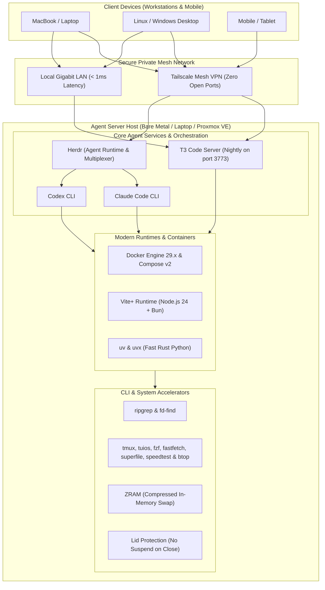
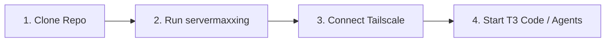

<div align="center">

# servermaxxing

**Turn any Ubuntu Server, homelab box, laptop, or Proxmox instance into a dedicated, high-performance remote AI coding agent workstation.**

[](LICENSE)
[](#)
[](docs/proxmox.md)
[](docs/multi-node-deployment.md)
[](https://tailscale.com)

</div>

---

## 🏗️ System Architecture



---

## ⚡ Quick Start



### Method 1: Instant One-Liner (Recommended for Existing Ubuntu/Debian Servers)

Run directly on your target server using process substitution (preserves `stdin` and avoids interactive truncation):

```bash
sudo bash <(curl -fsSL https://raw.githubusercontent.com/kshanxs/servermaxxing/main/scripts/servermaxxing.sh)
```

> [!TIP]
> **Fresh Cloud VPS / Root Logins:** On a newly created cloud VM (DigitalOcean, Hetzner, Linode) where you are logged in as `root` without `curl` or a standard user, create a dedicated agent user first to keep container runtimes and files out of `/root`:
> ```bash
> apt-get update -y && apt-get install -y curl
> id -u dev &>/dev/null || (adduser --disabled-password --gecos "" dev && usermod -aG sudo dev)
> su - dev -c "sudo bash <(curl -fsSL https://raw.githubusercontent.com/kshanxs/servermaxxing/main/scripts/servermaxxing.sh)"
> ```

> [!NOTE]
> **Tailscale Pre-Authentication:** To have the node connect to Tailscale automatically without interactive prompts, pass your auth key:
> ```bash
> sudo TAILSCALE_AUTHKEY="tskey-auth-..." bash <(curl -fsSL https://raw.githubusercontent.com/kshanxs/servermaxxing/main/scripts/servermaxxing.sh)
> ```

### Method 2: Agent Auto-Launch (Provision & Hand Off Directly to Claude / Codex)

If you want the machine tuned and immediately handed over to an interactive coding agent to verify, inspect, or manage the box:

```bash
# Launch Claude Code directly after servermaxxing:
sudo bash <(curl -fsSL https://raw.githubusercontent.com/kshanxs/servermaxxing/main/scripts/servermaxxing.sh) --agent claude

# Launch Codex CLI directly after servermaxxing:
sudo bash <(curl -fsSL https://raw.githubusercontent.com/kshanxs/servermaxxing/main/scripts/servermaxxing.sh) --agent codex

# Launch persistent Herdr / TUI multi-agent workspace:
sudo bash <(curl -fsSL https://raw.githubusercontent.com/kshanxs/servermaxxing/main/scripts/servermaxxing.sh) --agent herdr
```

> [!IMPORTANT]
> The script automatically installs the requested agent CLI, seeds the `servermaxxing` skill into `~/.agents/skills/`, and drops privileges from `root` to your normal user account so agents run securely with standard user ownership.

### Method 3: Clone & Run (For Full Visibility & Custom Tweaks)

```bash
git clone https://github.com/kshanxs/servermaxxing.git
cd servermaxxing
sudo bash servermaxxing.sh
# Or pass --agent claude / --agent codex
```

---

## 📂 Repository Structure

```
servermaxxing/
├── README.md                     # Main project portal & architecture overview
├── LICENSE                       # MIT open source license
├── servermaxxing.sh              # Root execution entrypoint
├── scripts/
│   └── servermaxxing.sh          # Automated server tuning & provisioning script
└── docs/
    ├── setup.md                  # Comprehensive Ubuntu bare-metal setup guide
    ├── proxmox.md                # Proxmox VE (LXC & VM) deployment guide
    └── multi-node-deployment.md  # Dynamic multi-node LAN deployment guide
```

---

## 📖 Documentation & Guides

| Guide | Description | Target Use Case |
| :--- | :--- | :--- |
| **[Ubuntu Server Setup Guide](docs/setup.md)** | End-to-end installation walkthrough covering base packages, non-interactive sudo, laptop lid policies, ZRAM swap, Docker, Tailscale, runtimes (`uv`, `vite-plus`), and AI agents (**T3 Code**, **Claude Code**, **Codex**). | Bare-metal servers, repurposed laptops, mini-PCs |
| **[Proxmox VE Setup Guide](docs/proxmox.md)** | Guide for deploying dedicated agent nodes in Proxmox VE using lightweight unprivileged **LXC containers** (with Docker nesting & Tailscale tun pass-through) or **KVM VMs** (with Cloud-Init & GPU passthrough). Includes host optimizations. | Homelabs, hypervisors, VM clusters |
| **[Multi-Node LAN Deployment](docs/multi-node-deployment.md)** | Dynamic architecture guide for decoupling **Development / Agent Nodes** from **Production / Database Nodes** on LAN or Tailscale. Covers zero-password SSH key auth, remote Docker contexts (`docker --context`), and GitOps webhooks. | Multi-machine LANs, dedicated DB/App split |
| **[Automated Tuning Script](scripts/servermaxxing.sh)** | Adaptive first-run provisioning engine that auto-detects **VPS vs. Laptop vs. Bare-Metal**, disables bloat daemons, masks sleep/suspend, configures 24/7 laptop lid & battery health caps, sets up **Tailscale Mesh VPN**, **Docker Engine**, in-memory **ZRAM swap**, modern runtimes (**`uv`**, **`Vite+`**), and agent CLI utilities. | Fast automated provisioning for VPS, laptops & homelabs |

---

## 🛠️ The Agent Stack

| Layer | Component | Description |
| :--- | :--- | :--- |
| **Agent Daemons & Orchestration** | **T3 Code (Nightly)** | Collaborative browser & editor server running as a persistent systemd service |
| | **Herdr (`herdr`)** | Dedicated agent runtime holding persistent terminal sessions across machines |
| | **Claude Code** | Anthropic's official agentic terminal assistant |
| | **Codex** | Independent agent CLI & developer execution environment |
| **Remote Access** | **Tailscale** | Encrypted WireGuard-based private mesh network with zero open public ports |
| **Containers** | **Docker Engine & Compose** | Containerized services, test environments, and database stacks |
| **Modern Runtimes** | **Vite+ (`vp`)** | High-performance JavaScript/TypeScript runtimes (Node.js & Bun) |
| | **uv & uvx** | Ultra-fast Rust-based Python package manager and runner |
| | **GitHub CLI (`gh`)** | Fast repository management and PR workflows directly from terminal |
| **Performance Tuning** | **ZRAM (`zstd`)** | In-memory compressed RAM swap preventing disk thrashing on heavy agent builds |
| | **Lid Protection** | Prevents suspension on laptop servers when closed or unplugged |
| **CLI Accelerators & Multiplexing** | **tuios (`tuios`)** | Terminal window manager with tiling, agent pane detection, and aggregated approval Inbox |
| | **tmux** | Terminal multiplexer for persistent sessions |
| | **ripgrep (`rg`)** | Blazing-fast symbol and pattern search across large codebases |
| | **fd-find (`fd`)** | Smart, fast directory and file finding |
| | **fzf** | Interactive command-line fuzzy finder |
| | **fastfetch & neofetch**| Instant system and hardware information fetchers |
| | **superfile (`spf`)** | Modern terminal file manager with multi-panel exploration and preview |
| | **speedtest** | Official Ookla native speedtest CLI for WAN bandwidth and latency diagnostics |
| | **btop & htop** | Visual real-time CPU, memory, and process tree monitors |

---

## 🔒 Security & Privacy

* **No Credentials Stored**: All configs and scripts are completely generic and use system environment variables (`$USER`, `$SUDO_USER`).
* **Zero Public Port Exposure**: All remote access operates over your private encrypted Tailscale network or local subnet.
* **Non-Root Docker Execution**: Your primary user is placed in the `docker` group for rootless container operations.

---

## 📄 License

MIT License. Feel free to use, modify, and distribute for your own homelab or cloud server setups.
