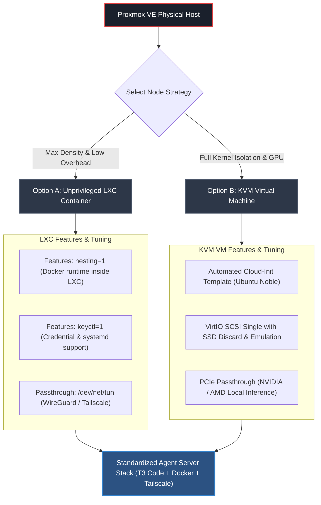

# Proxmox VE Setup Guide for AI Coding Agents & Remote Dev Boxes

A battle-tested guide for running dedicated **AI Agent nodes** (T3 Code, Claude Code, Codex, Docker, Tailscale) inside **Proxmox Virtual Environment (PVE)** using either **LXC Containers** (maximum resource efficiency) or **KVM Virtual Machines** (full kernel isolation & GPU passthrough).

---

## 1. LXC Container vs. KVM VM: Which to Choose?



| Feature | LXC Container | KVM Virtual Machine |
| :--- | :--- | :--- |
| **Overhead** | Almost zero (shares host kernel) | Low (~1-2 GB base RAM overhead) |
| **Boot Time** | Instant (< 2 seconds) | Fast (15-30 seconds) |
| **Docker Support** | Requires `nesting=1` & `keyctl=1` | Native (any kernel / distribution) |
| **GPU Passthrough** | LXC device node mapping (CUDA) | Full PCIe passthrough (NVIDIA / AMD) |
| **Best For** | Resource-constrained hosts, CPU-only agents | Heavy agent builds, GPU inference, full isolation |

---

## 2. Option A: High-Performance LXC Container (Recommended for CPU Nodes)

LXC gives near-bare-metal compute and RAM performance, perfect for running multi-agent tasks on home labs.

### Step 1: Download Ubuntu Template
In the Proxmox web shell or SSH:

```bash
pveam update
pveam download local ubuntu-24.04-standard_24.04-2_amd64.tar.zst
```

### Step 2: Create the Container
You can create it via the PVE GUI or CLI:

```bash
# Example CTID: 105
pct create 105 local:vztmpl/ubuntu-24.04-standard_24.04-2_amd64.tar.zst \
  --hostname agent-box \
  --cores 4 \
  --memory 8192 \
  --swap 2048 \
  --rootfs local-lvm:40 \
  --net0 name=eth0,bridge=vmbr0,ip=dhcp \
  --unprivileged 1 \
  --features nesting=1,keyctl=1 \
  --onboot 1
```

> [!IMPORTANT]
> **Key Configuration Flags**:
> * `nesting=1`: Required for Docker and container runtimes to operate inside LXC.
> * `keyctl=1`: Required for systemd and Docker credential management in unprivileged LXC.

### Step 3: Enable Tailscale Inside Unprivileged LXC
Tailscale requires access to `/dev/net/tun`. Add this configuration to `/etc/pve/lxc/105.conf` on the Proxmox host:

```bash
cat << 'EOF' >> /etc/pve/lxc/105.conf
# Tailscale TUN device passthrough
lxc.cgroup2.devices.allow: c 10:200 rwm
lxc.mount.entry: /dev/net/tun dev/net/tun none bind,create=file
EOF
```

Start and enter the container:
```bash
pct start 105
pct enter 105
```

Inside the container, ensure correct device permissions:
```bash
chown 100000:100000 /dev/net/tun 2>/dev/null || chmod 666 /dev/net/tun
```

---

## 3. Option B: KVM Virtual Machine (With Cloud-Init & Optional GPU Passthrough)

Use a KVM VM when you want full OS isolation, specific kernel modules, or PCIe GPU passthrough for local LLMs/embeddings.

### Step 1: Create an Automated Cloud-Init Template
Run on the Proxmox host to build a clean Ubuntu Cloud-Init VM:

```bash
# Variables
VMID=9000
STORAGE=local-lvm

# Download Ubuntu Cloud Image
wget -q https://cloud-images.ubuntu.com/minimal/releases/noble/release/ubuntu-24.04-minimal-cloudimg-amd64.img

# Create VM
qm create $VMID --name "ubuntu-cloud-template" --memory 8192 --cores 4 --cpu host \
  --net0 virtio,bridge=vmbr0

# Import disk and configure VirtIO SCSI
qm importdisk $VMID ubuntu-24.04-minimal-cloudimg-amd64.img $STORAGE
qm set $VMID --scsihw virtio-scsi-single --scsi0 $STORAGE:vm-$VMID-disk-0,discard=on,ssd=1
qm set $VMID --ide2 $STORAGE:cloudinit
qm set $VMID --boot c --bootdisk scsi0
qm set $VMID --serial0 socket --vga serial0
qm set $VMID --agent enabled=1

# Convert to template
qm template $VMID
```

### Step 2: Clone & Deploy
Clone the template to a new VM (e.g. ID `200`), expand disk to 60GB+, set your SSH keys in the Cloud-Init tab, and boot:

```bash
qm clone 9000 200 --name "agent-node" --full
qm resize 200 scsi0 +40G
qm start 200
```

---

## 4. Deploying the Agent Stack Inside the Container / VM

Once logged into your LXC or VM, run the setup steps to provision the full AI coding agent environment:

```bash
# 1. Clone the repository
git clone https://github.com/kshanxs/servermaxxing.git
cd servermaxxing

# 2. Run the tuning script
sudo bash servermaxxing.sh

# 3. Follow docs/setup.md for Tailscale and T3 Code service
```

---

## 5. Proxmox Host Post-Installation Optimization (Home Lab Best Practices)

If running a dedicated homelab Proxmox host:

### 1. Disable Enterprise Repo & Enable No-Subscription Repo
```bash
# Disable enterprise repository
sed -i.bak "s/^deb/#deb/" /etc/apt/sources.list.d/pve-enterprise.list 2>/dev/null || true

# Add no-subscription repository
cat << 'EOF' > /etc/apt/sources.list.d/pve-no-subscription.list
deb http://download.proxmox.com/debian/pve bookworm pve-no-subscription
EOF

apt update && apt dist-upgrade -y
```

### 2. Disable Subscription Nag Dialog
```bash
echo "DPkg::Post-Invoke { \"dpkg -V proxmox-widget-toolkit | grep -q '/proxmoxlib\.js$'; if [ \$? -eq 1 ]; then { echo 'Removing subscription nag...'; sed -Ezi.bak \\\"s/(Ext.Msg.show\\(\\{\\s+title: gettext\\('No valid sub)/void\\(\\} catch \\(err\\) \\{\\} /\\\" /usr/share/javascript/proxmox-widget-toolkit/proxmoxlib.js && systemctl restart pveproxy.service; }; fi\"; };" > /etc/apt/apt.conf.d/no-nag-script
apt --reinstall install proxmox-widget-toolkit
```

### 3. CPU Governor for Energy vs Performance
To allow low idle wattage while allowing AI agent compilations to scale instantly:
```bash
apt install -y cpufrequtils
echo 'GOVERNOR="schedutil"' > /etc/default/cpufrequtils
systemctl restart cpufrequtils
```

---

## 6. Snapshot & Backup Best Practices

Before asking an AI agent to execute complex multi-file refactors or docker stack builds:
1. **Take an LXC / VM Snapshot**:
   ```bash
   pct snapshot 105 "pre-agent-refactor" --description "Snapshot before autonomous agent task"
   ```
2. **Instant Rollback if needed**:
   ```bash
   pct rollback 105 "pre-agent-refactor"
   ```
This guarantees you can experiment with full autonomous agents without risking your host environment.
